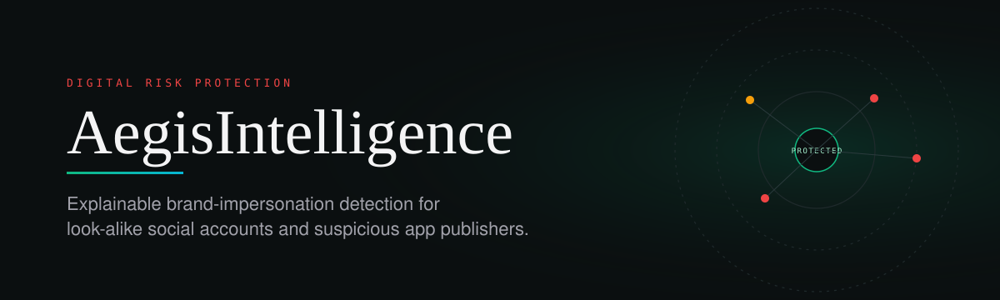
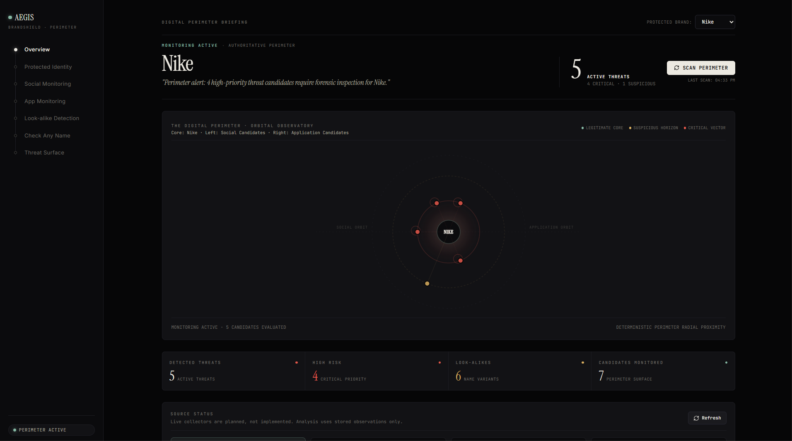
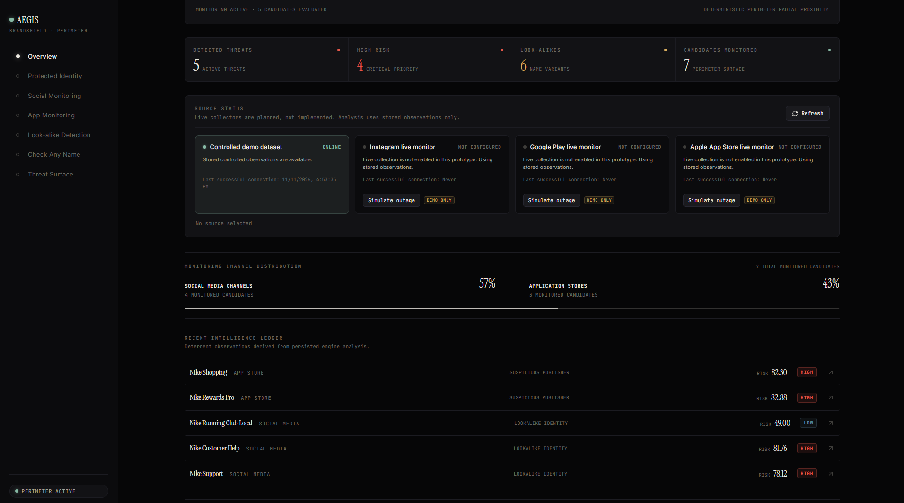
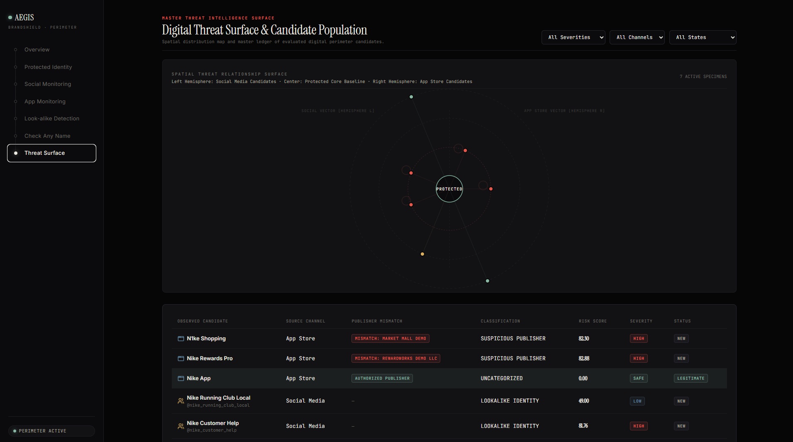
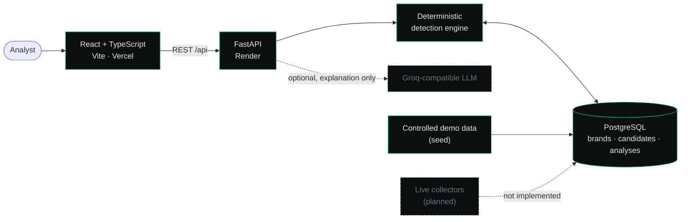

<div align="center">



<br>

[](#hackathon-project)
[](#current-limitations)
[](frontend)
[](backend)
[](docker-compose.yml)

### [**Live Demo**](https://aegis-intelligence-beta.vercel.app/) &nbsp;·&nbsp; [**API Docs**](https://brandshield-40ce.onrender.com/docs) &nbsp;·&nbsp; [**Architecture**](docs/ARCHITECTURE.md) &nbsp;·&nbsp; [**Setup**](docs/SETUP.md)

</div>

---

## Overview

Attackers register accounts and publish apps that imitate well-known brands (`N1ke Shopping`, `@nike_customer_help`) to phish customers. Spotting them means comparing every candidate against what the brand officially owns, and explaining *why* something is suspicious.

**AegisIntelligence** (repository name; some internal files still say *BrandShield*) is a Digital Risk Protection prototype that does exactly that. It stores a protected brand's official identity, compares observed social-account and app-store candidates against it, and scores each one with a **deterministic, evidence-backed engine**. An optional LLM analyst can explain a finding, but it never changes the score.

> **Scope note.** The current build analyses **stored observations and a controlled demo dataset**. Live collectors for Instagram, Google Play and the Apple App Store are **planned, not implemented**. See [Current limitations](#current-limitations).

## Screenshots

<table>
  <tr>
    <td colspan="2" align="center">
      <br>
      <sub><b>Overview.</b> Per-brand briefing with an orbital view of the protected core (centre), social candidates (left) and app candidates (right), plus threat counters.</sub>
    </td>
  </tr>
  <tr>
    <td width="50%" align="center">
      <br>
      <sub><b>Source status and intelligence ledger.</b> Collector state is shown honestly: only the demo dataset is online. Ledger rows come from persisted engine analysis.</sub>
    </td>
    <td width="50%" align="center">
      <br>
      <sub><b>Threat Surface.</b> Radial map of candidates around the protected baseline, with a ledger showing publisher mismatch, classification, risk score and severity.</sub>
    </td>
  </tr>
</table>

<sub>Screenshots show the controlled demo dataset for the brand "Nike". They do not represent live monitoring.</sub>

## Features

| Capability | What it does |
|---|---|
| **Protected identity** | Persists a brand's official social accounts, apps and assets as the comparison baseline. |
| **Social and app candidate analysis** | Scores observed social accounts and app-store listings against the baseline. |
| **Look-alike detection** | Flags name variants and character substitutions (e.g. `N1ke`). |
| **Publisher mismatch** | Compares an app's publisher against the authorised publisher; mismatches raise risk. |
| **Check any name** | Ad-hoc analysis of an arbitrary name via `POST /api/analyze/name`. |
| **Threat Surface** | Radial visualisation and filterable ledger (severity, channel, state). |
| **Source status panel** | Reports which collectors are configured; live sources show as *Not configured*. |
| **Explainable scoring** | Each result carries ordered, structured evidence. Similarity alone is capped below `MEDIUM`. |
| **Optional AI analyst** | Server-side, Groq-compatible LLM that *explains* findings. Falls back to a deterministic explanation without an API key. |
| **Draft-only remediation** | Generates takedown drafts marked *DRAFT ONLY, NOT SENT*. |

## Architecture



The detection pipeline and data model are documented in [docs/ARCHITECTURE.md](docs/ARCHITECTURE.md).

## Technology stack

| Layer | Technology |
|---|---|
| Frontend | React, TypeScript, Vite |
| Backend | FastAPI, SQLAlchemy, Alembic, Python 3.13 |
| Database | PostgreSQL (Docker Compose) |
| Analyst (optional) | Groq-hosted `openai/gpt-oss-120b` via an OpenAI-compatible endpoint |
| Tooling | Docker Compose, pytest, Postman collections |
| Hosting | Vercel (frontend), Render (API) |

## Repository structure

```text
AegisIntelligence/
├── frontend/            React + TypeScript (Vite) UI and API client
├── backend/             FastAPI app, SQLAlchemy models, Alembic migrations, tests
├── data/                Controlled seed / demo data
├── scripts/             Automation helpers
├── docs/
│   ├── ARCHITECTURE.md  System and detection-pipeline design
│   ├── SETUP.md         Detailed local setup
│   ├── assets/          README artwork
│   └── screenshots/     Application screenshots
├── .postman/, postman/  Postman collection and globals
├── docker-compose.yml   Local PostgreSQL
└── .env.example         Environment template
```

## Quick start

```bash
cp .env.example .env              # then set a local POSTGRES_PASSWORD
docker compose up -d postgres
cd backend && python -m alembic upgrade head && python -m app.seed
python -m uvicorn app.main:app --reload --port 8001
# new terminal
npm install --prefix frontend && npm run dev --prefix frontend
```

Open `http://localhost:5173`. Full instructions, including the Python 3.13 virtual environment, are in [docs/SETUP.md](docs/SETUP.md).

## Environment variables

Copy `.env.example` to `.env`. The file is git-ignored; never commit real values.

| Variable | Purpose | Default in template |
|---|---|---|
| `POSTGRES_DB` / `POSTGRES_USER` | Database name and user for Docker Compose | `brandshield` |
| `POSTGRES_PASSWORD` | Local database password. **Set your own.** | placeholder |
| `POSTGRES_PORT` | Host port for PostgreSQL | `5432` |
| `DATABASE_URL` | SQLAlchemy URL. The password must match `POSTGRES_PASSWORD`. | local URL |
| `CORS_ORIGINS` | Allowed frontend origin(s) | `http://localhost:5173` |
| `VITE_API_BASE_URL` | API base URL used by the frontend. It must match the port you run uvicorn on. | `http://127.0.0.1:8001` |
| `LLM_API_KEY` | Optional Groq key. Leave blank for the deterministic fallback. | empty |
| `LLM_MODEL` | Analyst model | `openai/gpt-oss-120b` |
| `LLM_BASE_URL` | OpenAI-compatible endpoint | `https://api.groq.com/openai/v1` |
| `LLM_TIMEOUT_SECONDS` | Analyst request timeout | `20` |

## API

Interactive reference: **[Swagger UI](https://brandshield-40ce.onrender.com/docs)**.

| Area | Endpoints |
|---|---|
| Health and dashboard | `GET /api/health` · `GET /api/dashboard/overview` |
| Brands and assets | `GET` `POST /api/brands` · `GET` `PATCH /api/brands/{id}` · `GET /api/brands/{id}/assets` |
| Official identity | `GET` `POST /api/brands/{id}/social-accounts` · `GET` `POST /api/brands/{id}/apps` |
| Candidates | `GET` `POST /api/brands/{id}/social-candidates` · `GET` `POST /api/brands/{id}/app-candidates` |
| Analysis and detections | `POST /api/analyze/name` · `POST /api/analyze/social/{candidate_id}` · `POST /api/analyze/app/{candidate_id}` · `POST /api/detections/scan` · `GET /api/detections` · `GET /api/detections/{id}` |
| Monitoring | `POST /api/monitoring/scan` · `GET /api/monitoring/runs` · `GET /api/monitoring/runs/{id}` |
| Sources | `GET /api/sources/status` |
| Investigation | `GET /api/detections/{id}/investigation` · `POST /api/detections/{id}/status` · `POST /api/detections/{id}/notes` · `POST /api/detections/{id}/remediation-drafts` · `POST /api/detections/{id}/analyze` |

All records are local, controlled demo data. The Swagger UI is the source of truth if it differs from this table.

## Current limitations

**Implemented:** persisted brand baseline, candidate storage, deterministic scoring with evidence, threat-surface and overview UI, optional server-side analyst, draft-only remediation.

**Not implemented:**

- Live social-media and app-store collection. The source panel shows these as *Not configured*, and the "Simulate outage" controls are demo-only.
- Authentication and multi-tenant access control.
- Automated takedown submission. Drafts are never sent.
- Image or logo comparison. Remote logo URLs are reported as unavailable rather than scored.


**Roadmap**

1. Add deployment health checks and regression coverage.
2. Build the first live collector behind the existing source-status interface.
3. Add logo and visual similarity as an additional scoring signal.
4. Add authentication and per-organisation brand workspaces.
5. Add CI for backend tests and frontend builds.

## Hackathon Project

AegisIntelligence was developed as part of a hackathon. It is a prototype built under time constraints, and the limitations above reflect that scope.

## Credits

- **[Harsh](https://github.com/Harsh0012-ux)**: maintainer of this repository.
- **[Ram](https://github.com/Ram0kr0singh)**: collaborator on the original BrandShield work, available in [BrandShieldWEB](https://github.com/Ram0kr0singh/BrandShieldWEB).
