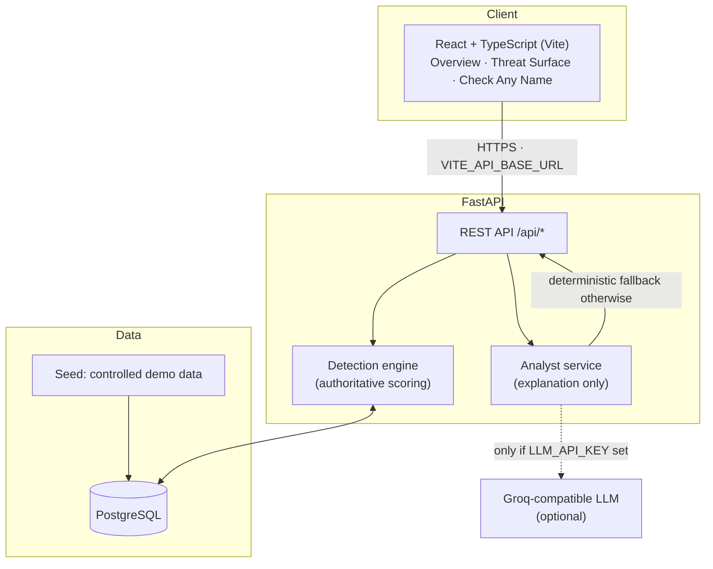
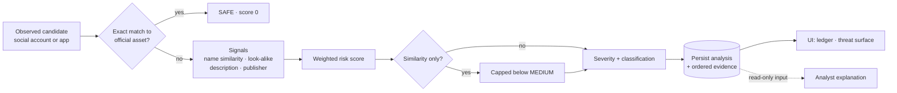

# AegisIntelligence architecture

AegisIntelligence is a three-tier prototype: a React SPA, a FastAPI service and PostgreSQL. All analysis is performed by a deterministic engine on stored observations.

## System overview

## Threat detection pipeline

Rules documented in the project:

- The engine is the single authority for score, severity, classification and evidence.
- Exact official-asset matches are always `SAFE`.
- A similarity-only result is capped below `MEDIUM`. The score is not a statistical confidence.
- Remote logo URLs are reported as unavailable instead of being given a fabricated score.
- The analyst can explain a result but cannot modify it.
- Remediation text is always marked *DRAFT ONLY, NOT SENT*.

The exact weights and thresholds live in the backend source and are not reproduced here.

## Data model

Created by the domain migration:

| Table | Purpose |
|---|---|
| `brands` | Protected brands |
| `official_social_accounts` | Authorised social handles |
| `official_apps` | Authorised apps and publishers |
| `official_brand_assets` | Official identity assets |
| `social_candidates` | Observed social accounts (`NEW`, `REVIEWED`, `IGNORED`) |
| `app_candidates` | Observed app listings (`NEW`, `REVIEWED`, `IGNORED`) |

The engine additionally persists one current analysis per candidate, with ordered evidence.

## Monitoring sources

| Source | State |
|---|---|
| Controlled demo dataset | Implemented |
| Instagram live monitor | Planned |
| Google Play live monitor | Planned |
| Apple App Store live monitor | Planned |

## Deployment

Frontend on Vercel, API on Render, PostgreSQL via Docker Compose for local development. The deployment configuration is intentionally not covered here.
