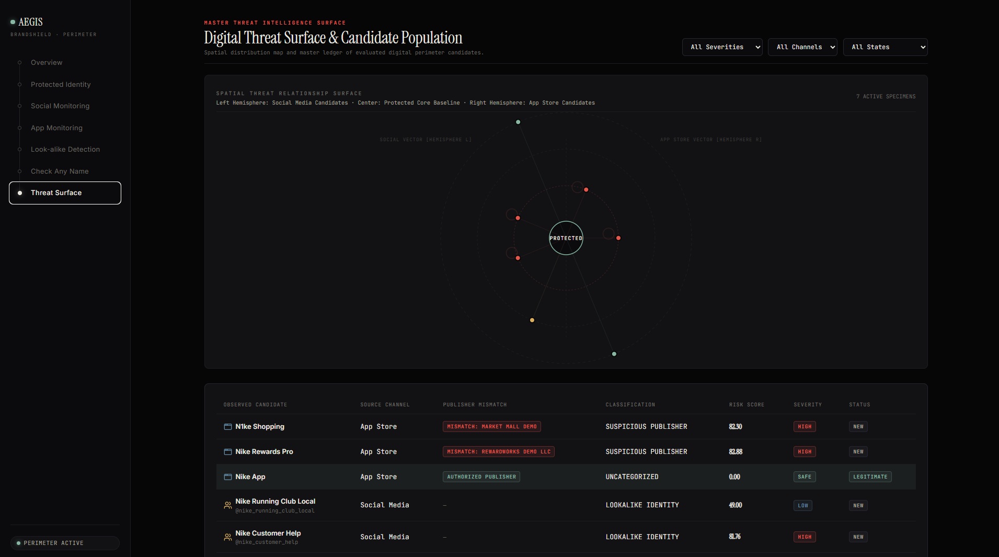

# Profile README snippet

Paste into `Harsh0012-ux/Harsh0012-ux/README.md`.

```markdown
### 🛡️ [AegisIntelligence](https://github.com/Harsh0012-ux/AegisIntelligence)

Digital risk protection prototype that detects look-alike social accounts and suspicious app publishers using a deterministic, explainable scoring engine. Built for a hackathon with React, TypeScript, FastAPI and PostgreSQL.

[](https://aegis-intelligence-beta.vercel.app/)
[](https://brandshield-40ce.onrender.com/docs)

<a href="https://github.com/Harsh0012-ux/AegisIntelligence">
  
</a>

`React` · `TypeScript` · `FastAPI` · `PostgreSQL` · `Docker`
```

The screenshot URL only works after the changes are pushed to `main`.
